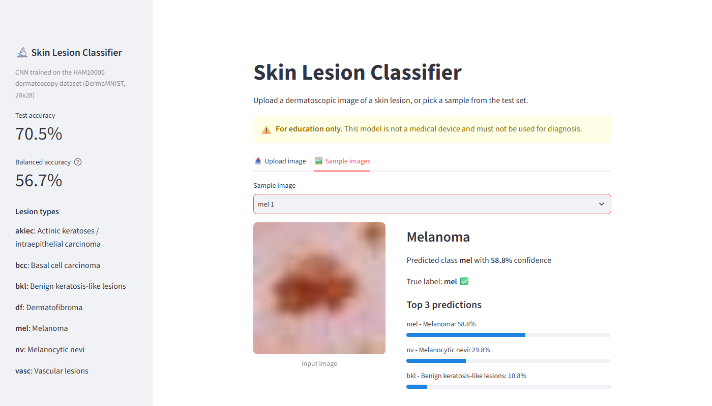
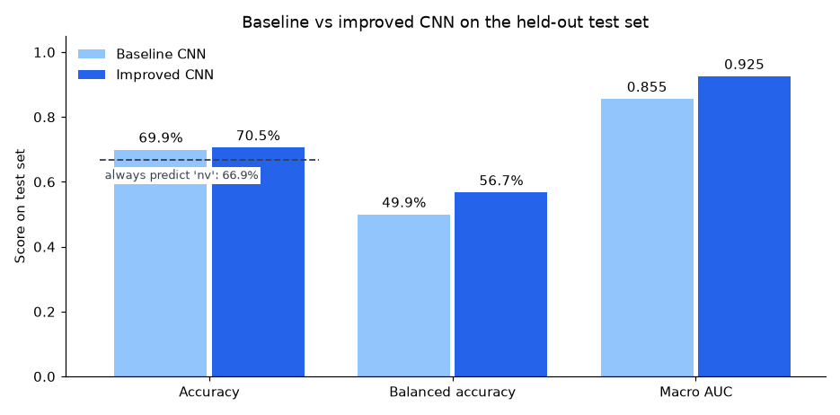
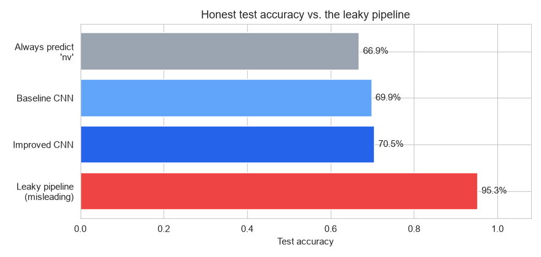
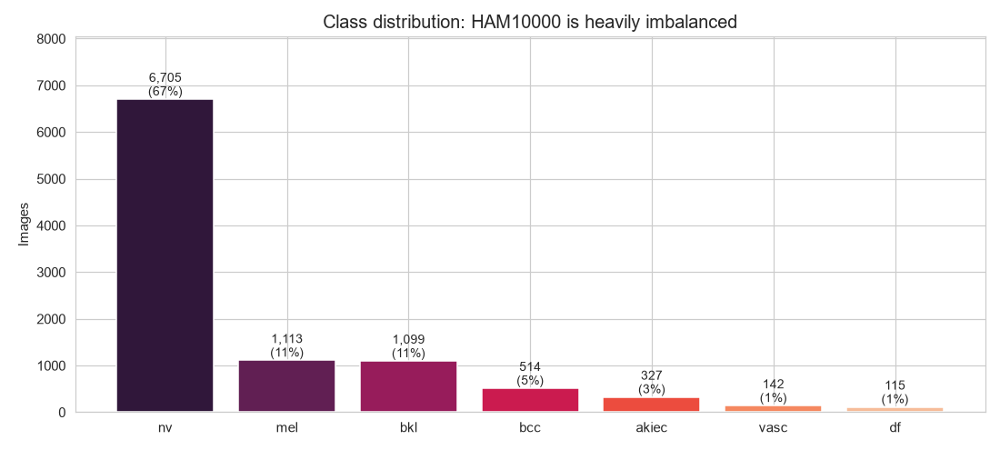
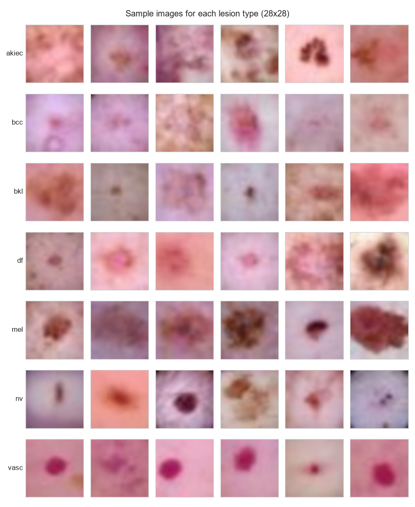
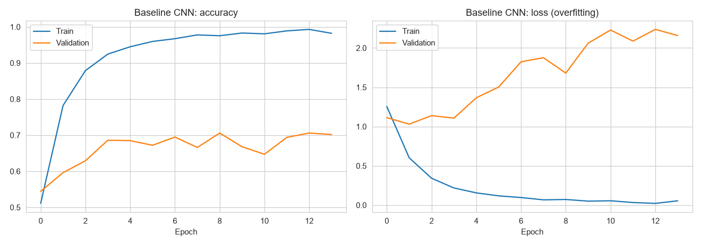
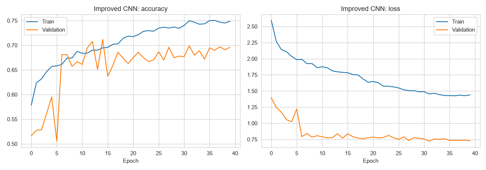
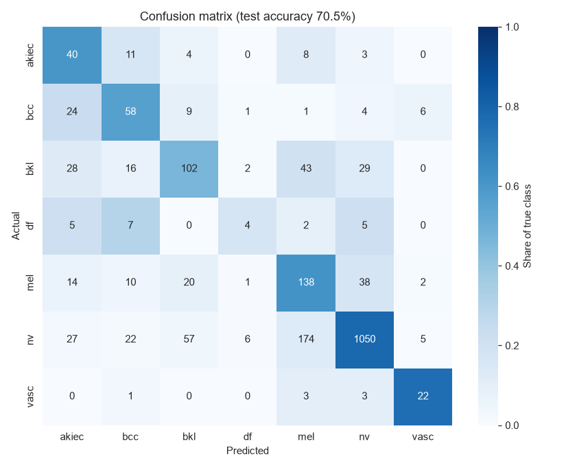
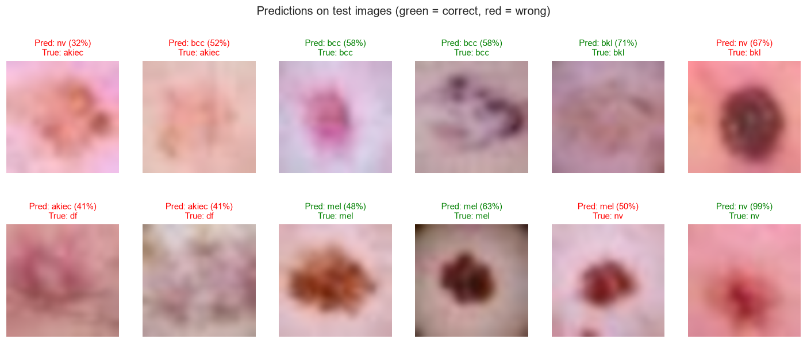

# Skin Lesion Classification with a CNN

A convolutional neural network that classifies dermatoscopic images into **7 types of skin lesion**, including melanoma. It's trained on the HAM10000 dataset with TensorFlow/Keras and comes with a Streamlit demo app.

The project also shows how a common preprocessing mistake, **oversampling before the train/test split**, makes a model look far better than it really is, and how to evaluate it properly.

**Live demo: [skin-lesion-classification-arslan.streamlit.app](https://skin-lesion-classification-arslan.streamlit.app/)**

[](https://skin-lesion-classification-arslan.streamlit.app/)



## Results

All scores are on the official DermaMNIST **test set** (2,005 images) that the model never saw during training.

| Model | Accuracy | Balanced accuracy | Macro AUC | Melanoma recall |
|-------|---------:|------------------:|----------:|----------------:|
| Always predict the most common class | 66.9% | 14.3% | n/a | 0% |
| Baseline CNN | 69.9% | 49.9% | 0.855 | 30.0% |
| **Improved CNN** | **70.5%** | **56.7%** | **0.925** | **61.9%** |
| *Leaky pipeline (oversample, then split)* | *95.3%* | *misleading* | | |

- The improved CNN's **macro AUC of 0.925** is above the published [MedMNIST v2](https://medmnist.com/) ResNet-18 benchmark for this dataset (0.917), with a much smaller network.
- It **doubles melanoma recall** compared with the baseline: it catches 62% of melanomas instead of 30%. Melanoma is the most dangerous class to miss.
- Plain accuracy is a poor metric here, because 67% of the images are a single benign class (`nv`). That's why balanced accuracy and AUC are reported too.



## The data-leakage trap

HAM10000 is heavily imbalanced. A common fix is random oversampling, which duplicates rare-class images until every class is the same size. If you do this **before** splitting into train and test sets, copies of the same image land on both sides:

| | Leaky pipeline | Correct pipeline |
|---|---|---|
| Order | oversample → split | split → oversample **training only** |
| Test images that also appear in training | **85.9%** | 0% |
| Test accuracy | 95.3% | 70.5% |

The 95% score just measures how well the model memorised duplicated images. The notebook reproduces both pipelines side by side.



## Dataset

[DermaMNIST](https://medmnist.com/) is the [HAM10000](https://doi.org/10.7910/DVN/DBW86T) dataset (10,015 dermatoscopic images) resized to 28×28 RGB, with official train / validation / test splits. See [data/README.md](data/README.md) for the download link and license.

| Code | Lesion type | Images |
|------|-------------|-------:|
| nv | Melanocytic nevi | 6,705 |
| mel | Melanoma | 1,113 |
| bkl | Benign keratosis-like lesions | 1,099 |
| bcc | Basal cell carcinoma | 514 |
| akiec | Actinic keratoses / intraepithelial carcinoma | 327 |
| vasc | Vascular lesions | 142 |
| df | Dermatofibroma | 115 |

<p>
  
  
</p>

## Models

**Baseline CNN:** four convolution layers (16 → 32 → 32 → 64 filters), two max-pooling layers and dense layers of 64 and 32 units, trained on an oversampled training set. It overfits heavily, reaching about 99% training accuracy against about 70% on validation.



**Improved CNN:** built to fix that overfitting.
- **Data augmentation:** random flips, rotations and zoom. Lesions have no natural orientation, so these keep the label the same.
- **Three convolution blocks** (32 → 64 → 128 filters) with **batch normalisation**.
- **Global average pooling and dropout** instead of a large flattened dense layer.
- **Softened class weights** instead of oversampling, so it trains on the 7,007 real images rather than duplicates.
- **Learning-rate reduction and early stopping** on validation loss.



### Confusion matrix (improved CNN)



The most common confusions are between visually similar classes: benign moles (`nv`) and melanoma (`mel`), and the keratosis-type lesions (`akiec`, `bkl`, `bcc`). Dermatologists find these hard to tell apart too, especially at 28×28 resolution.



## Getting started

```bash
git clone https://github.com/arslanahmedbhutto/skin-lesion-classification.git
cd skin-lesion-classification
pip install -r requirements.txt
```

**Run the demo app** (the trained model is included):

```bash
streamlit run app.py
```

**Retrain the models:** download the dataset (see [data/README.md](data/README.md)), then run `skin_lesion_classification.ipynb`. On a CPU, the full notebook takes about 45 minutes.

## Project structure

```
skin-lesion-classification/
├── skin_lesion_classification.ipynb  # EDA, leakage experiment, both models, evaluation
├── app.py                            # Streamlit demo
├── src/skin_lesion.py                # Data loading, preprocessing, model definitions
├── scripts/plot_comparison.py        # Model comparison chart
├── model/
│   ├── skin_lesion_cnn.keras         # Trained improved CNN
│   ├── preprocessing.json            # Training-set mean/std used to standardise inputs
│   └── results.json                  # Test-set metrics
├── samples/                          # Example test images for the app
├── data/README.md                    # Dataset download and license
└── screenshots/
```

## Tech stack

Python · TensorFlow / Keras · scikit-learn · NumPy · Matplotlib · Seaborn · Streamlit

## Disclaimer

This is an educational project. The model is **not a medical device** and must not be used to diagnose skin conditions. Please see a dermatologist about any concerning skin lesion.

## Acknowledgements

The dataset is from MedMNIST v2 (Yang et al., 2023) and HAM10000 (Tschandl et al., 2018), used under CC BY-NC 4.0.
